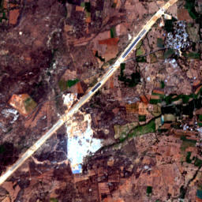
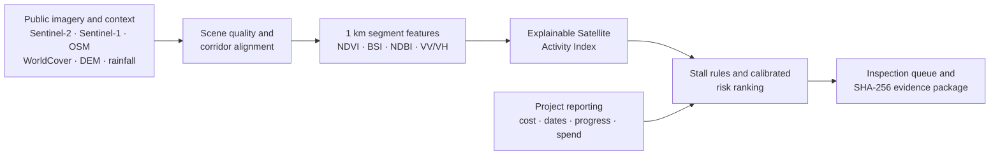

# DRISHTI

### Satellite intelligence for infrastructure verification

[](https://github.com/armanojha/AR-5-RAPTAA/actions/workflows/ci.yml)
[](LICENSE)
[](pyproject.toml)
[](frontend/package.json)
[](docs/DATA_AND_VALIDATION.md)

**Which part of a large infrastructure corridor should an authority verify first?** Drishti turns public satellite observations and project reporting into a segment-level, explainable inspection queue. It combines optical and radar change signals, weather and land-cover context, a delay-risk ranker, and date-stamped evidence packages.

> **Scope:** Drishti measures *observable surface activity*, not certified engineering completion. An alert requests field verification; it is not a finding of delay, misconduct, encroachment, or illegal activity.

## What you can explore

| Workspace | What it shows |
| --- | --- |
| **Overview** | Corridor map, status distribution, activity trends, verification queue and portfolio summary. |
| **Project Explorer** | OSM-aligned segments, project context and satellite activity by corridor. |
| **Satellite Evidence** | Before/after optical chips, radar context, scene telemetry and explainable findings. |
| **Milestone Verification** | Observable signals alongside reported milestones, with explicit observability limits. |
| **Financial Analysis** | Reported spending and progress alongside surface activity for audit prioritization. |
| **Project Alerts / Risk & Track C** | Segment-level delay-risk alerts and separate protective land-change candidates. |
| **Reports & Documents** | Downloadable evidence manifests, HTML reports and PDFs. |

The included case study covers **three corridors**: NH-544G Package 1 highway, Rishikesh–Karnaprayag rail, and Kacchi Dargah–Bidupur bridge. The checked-in bundle also contains **two clearly labelled synthetic portfolio placeholders**. Its latest satellite observation is **31 March 2025**; the interface is interactive, while imagery refresh requires rebuilding the pipeline.



*Example Sentinel-2 image chip from the included NH-544G case study.*

## How it works



The activity index combines seven interpretable optical, radar and continuity signals. The risk model is a monotonic-constrained `HistGradientBoostingClassifier` with sigmoid calibration when sufficient class examples are available. Tunnel and other low-observability sections can be marked **not assessable**. Track C separately examines protected corridor polygons for land-change candidates. See [architecture](docs/ARCHITECTURE.md) and [data and validation notes](docs/DATA_AND_VALIDATION.md).

## Run the demo

**Requirements:** Python 3.11+, Node.js 20+, npm. The checked-in frontend bundle lets you launch the interface without downloading imagery or running a Python backend.

```bash
git clone https://github.com/armanojha/AR-5-RAPTAA.git
cd AR-5-RAPTAA/frontend
npm ci
npm run dev
```

Open the URL printed by Vite (normally `http://localhost:5173`). To make a production frontend build, run `npm run build` in `frontend/`.

### Rebuild the case-study evidence

The cached public-data summaries and image chips are included. Large GeoTIFF/NumPy raster windows are excluded from Git, so a **fresh clone must ingest them first**. Ingestion needs internet access and can take time.

```bash
cd AR-5-RAPTAA
python -m venv .venv
# Activate .venv for your shell, then:
python -m pip install -e .
python scripts/ingest_real_satellite_cache.py
python -m drishti real-demo build --output-dir output/real_case
```

The build writes audit outputs to `output/real_case/` and refreshes `frontend/public/drishti_bundle.json` plus `frontend/public/drishti_assets/`. The frontend reads that generated bundle by default. An optional local API can serve the same file:

```bash
python -m drishti alerts serve --evidence-dir output/real_case/evidence --bundle frontend/public/drishti_bundle.json
```

Set `VITE_DRISHTI_API_BASE=http://127.0.0.1:8765` in `frontend/.env.local` to use API mode. The API exposes `/health`, `/bundle`, `/alerts` and segment timelines.

## Repository map

| Path | Purpose |
| --- | --- |
| [`src/drishti/layers/`](src/drishti/layers/) | Ingestion, quality, features, activity index, risk, validation and evidence logic. |
| [`src/drishti/real_case.py`](src/drishti/real_case.py) | Three-corridor orchestration and bundle build. |
| [`scripts/`](scripts/) | Public-data ingestion and build entry points. |
| [`frontend/`](frontend/) | React + TypeScript + Vite dashboard. |
| [`data/`](data/) | Sample fixtures and cached public-data metadata/chips. |
| [`tests/`](tests/) | Unit, contract and data-dependent integration tests. |
| [`docs/`](docs/) | Architecture, provenance, limitations and demo guide. |

## Verification and limitations

```bash
python -m unittest discover -s tests -v
cd frontend && npm run build
```

Tests requiring the untracked raster cache or generated `output/real_case/` artifacts are skipped when those inputs are absent. The current demo's automatically assigned stall labels are **not independent field ground truth**. Its reported precision, recall and training-set Brier score must not be presented as deployment accuracy. See [Data and validation](docs/DATA_AND_VALIDATION.md) for exact provenance and the validation plan.

## Contributing and responsible use

See [CONTRIBUTING.md](CONTRIBUTING.md) for development and data-provenance rules. Drishti does not track people, replace engineering inspections, authorize payments, or make enforcement decisions. The software is available under the [MIT License](LICENSE); upstream imagery and data retain their own terms.

**Suggested GitHub topics:** `geospatial`, `remote-sensing`, `satellite-imagery`, `infrastructure`, `construction-monitoring`, `sentinel-1`, `sentinel-2`, `machine-learning`, `react`, `python`.
